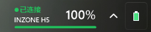

# InzoneBattery

给索尼 INZONE H5 用的电量小工具。

Windows 自带的电量显示对这类 USB 接收器耳机往往只有很粗的档位，甚至一直不变。
这个小工具绕过系统，直接向接收器的 HID 控制通道查询，拿到耳机固件自己上报的 **0–100 百分比**，显示在一个可拖动的小悬浮窗里，同时提供一个托盘图标。
> 与 Sony 无关联。InzoneBattery 是一个独立项目。它不隶属于 Sony Group Corporation 或其任何关联公司，也未获得其授权、赞助或认可。“Sony”、“INZONE”和“INZONE Hub”是 Sony Group Corporation 或其关联公司的商标，此处仅用于标识本项目所互操作的硬件和厂商应用程序。


## 功能

- 悬浮窗：显示设备状态和电量
- 尺寸可自定义；可任意拖拽调整，最小尺寸 130×47，可以直接做成一条任务栏电量条（菜单里「任务栏大小」一键切换），可把当前宽高记录为「我的尺寸」，并作为尺寸菜单的默认项
- 拖动时吸附：靠近屏幕四边、屏幕水平中线、任务栏上沿会自动贴齐
- 可以拖到任务栏上显示；点击任务栏后悬浮窗会自动回到最上层（需开启窗口置顶）；兼容TranslucentTB
- 背景不透明度滑块（0%–100%）：只影响背景，文字和图形保持不透明；0% 时背景不可见但仍可点击
- 锁定位置：防止误拖动或误缩放；锁定时拖动会提示，解锁后恢复
- 托盘图标为电池，按电量变色，悬停显示百分比
- 电量低于 20%、10% 时弹一次通知
- 双击悬浮窗立即刷新状态和电量
- 可以和 INZONE Hub 同时运行，两边互不干扰



## 精简版（只有托盘图标）

仓库里的 [`lite/`](lite/) 是一个精简版：去掉悬浮窗、设置窗口和配置文件，只保留系统托盘里的一个电池图标。

- 图标本身就是电量条；在图标上悬停显示详细，左键点弹气泡，
- 自启动注册表值名是 `InzoneBatteryLite`，和完整版互不覆盖，两个可以同时开着
- 细节见 [lite/README.md](lite/README.md)


# 下载

到 [Releases](../../releases) 下载:
- 完整版 `InzoneBattery.exe`
- 精简版  `InzoneBatteryLite.exe`
- 双击即可运行无需安装,勾选上开机自启动后无需再理会

> 程序没有代码签名，首次运行 Windows SmartScreen 可能提示「Windows 已保护你的电脑」，点「更多信息 → 仍要运行」即可。因为这是个免费项目，没有代码签名——签署证书需要付费，不是因为文件有问题。也欢迎从源码自行编译。

## 外观设置

右键菜单里可以调：

- **悬浮窗大小**：拖右下角可以任意改宽高，最小 130×47、最大 720×420；菜单里还有「任务栏大小」（130×47）
  - 「记录当前尺寸为我的尺寸」会把当前宽高存成预设，「我的尺寸」默认勾选
- **背景透明度与效果…**：拖动滑块调整卡片背景的不透明度（0%–100%），文字和图形始终不透明
  - 0% 时卡片完全看不见，只剩文字和进度条；为了还能拖动 / 右键，实际按约 2.4% 的 alpha 绘制（肉眼不可见）
- **恢复默认**：把大小、位置、透明度、置顶、锁定一次性恢复成默认值（会先弹确认）
- **窗口置顶**：默认开启；关掉后会被其他窗口盖住
- **锁定位置**：防止误拖动或误缩放；锁定后左键拖会提示「位置已锁定」，右键菜单可解锁
- **吸附**：拖动或拉伸时，离屏幕边缘、水平中线、任务栏上沿 12px 以内会自动贴齐

把悬浮窗拖到任务栏上也能正常显示，位置会记住。

这些设置连同窗口位置都会存到 `%APPDATA%\InzoneBattery\settings.ini`，下次启动自动恢复。

# 几点提醒

- 目前只测试了INZONE H5 耳机, H3/H7/H9/H9II/Buds耳机为测试可行性
- 背景是真透明（逐像素分层窗口），但 Win11 的亚克力模糊在这种窗口上没生效，透出来的是清晰桌面而不是磨砂
- 通过微信 / QQ / 网盘 / 邮件传来的 exe 会带「网络来源」标记，首次运行 SmartScreen 会提示，点「更多信息 → 仍要运行」
- 个别杀软可能对未签名的自编译 exe 敏感，加白名单即可
- 只支持 Windows

## 托盘图标不显示？

先看日志 `%TEMP%\InzoneBattery-startup.log`（exe 同目录也会写一份 `startup.log` 兜底）：

- `tray icon added` —— 图标已交给系统；如果还是看不见，是 Windows 11 把它收进 `^` 溢出区了，可以拖出来，或在「设置 → 个性化 → 任务栏 → 系统托盘图标」里打开
- `tray add failed err=5` —— **拒绝访问**。说明这个 exe 文件带 **Low 完整性标签**：Explorer 会用受限令牌启动它，进程处于 Low 完整性级别，而任务栏是 Medium，`Shell_NotifyIcon` 被系统拒绝，于是完全没有图标（用 `cmd /c start` 从命令行启动反而正常，因为父进程是 High）
  - `build.ps1` 每次构建后会自动把 exe 的标签改回 Medium（等价于运行 `build\SetIntegrity.exe InzoneBattery.exe`，成功输出 `S:(ML;;NW;;;ME)`）
  - 如果把 exe 拷进了别的地方并看到这个错误，手动跑一次上面这条命令即可
  - 判断当前进程级别：`whoami /groups | findstr /i mandatory`，出现 `Low Mandatory Level` 就是 Low

程序启动后若 shell 还没准备好，会自动重试（最多 40 次，间隔 0.4 秒递增到 5 秒）；explorer 重启会收到 `TaskbarCreated` 并自动加回。

## 它怎么拿到电量的

INZONE 的 USB 接收器是一个复合设备，除了两个音频端点外还有一个厂商自定义 HID 集合（usage page `0xFF04`，64 字节报告）。这个通道跑的是一层仿蓝牙 HCI 的索尼私有协议：

- 命令包 12 字节：`01 00 FC 08 96 C3 41 <事件ID> <类型> <事务ID> <校验>`
- 电量是事件 `0x04`，`GET` 之后回一个 `RET`，参数两个字节：`[状态, 百分比]`
- 百分比 `0xFF` 表示耳机不在线（关机或超出范围）

## 卸载

退出程序，删除整个文件夹；如果开过开机自启，先在菜单里取消勾选（或删除注册表值 `HKCU\Software\Microsoft\Windows\CurrentVersion\Run\InzoneBattery`）。

## 目录

以下路径相对项目根目录：

```
InzoneBattery.exe     编译好的程序（Releases 里提供）
build.ps1             构建脚本（csc + 完整性标签修正）
src/InzoneHid.cs      HID 发现、协议、电量解析
src/Program.cs        入口、命令行
src/TrayApp.cs        托盘、轮询、菜单、设置、开机自启
src/TrayHost.cs       托盘图标（直接调 Shell_NotifyIcon，失败可重试、写日志）
src/Startup.cs        开机自启（注册表读写、校验、日志）
src/WidgetForm.cs     悬浮窗绘制、拖动与锁定
src/TrayIcon.cs       托盘图标绘制
src/SettingsForm.cs   背景透明度设置窗口
tools/make-icon.ps1   生成 exe 图标
tools/SetIntegrity.cs 把 exe 完整性标签设为 Medium（修托盘图标）
build/app.ico         程序图标
.github/workflows/    自动构建
```

## 命令行

项目目录（示例，按你的实际位置改）：`E:\InzoneBattery`

```
cd "E:\InzoneBattery"
InzoneBattery.exe --once        输出一次电量，例如 85；耳机离线输出 offline
InzoneBattery.exe --json        输出 JSON：型号、在线状态、百分比、充电状态
InzoneBattery.exe --watch 5     每 5 秒查询一次，值变化时打印
InzoneBattery.exe --diag        列出所有 HID 集合，排障用
InzoneBattery.exe --icon F      渲染竖向托盘图标到 PNG（可选尺寸参数）
InzoneBattery.exe --icon-old F  渲染旧版横向图标
InzoneBattery.exe --startup on|off|status   开机自启开关 / 状态
```

`--once` 适合放到别的脚本、状态栏工具或 OBS 文本源里。

## 许可

[MIT](LICENSE)

## 说明

- 与索尼无关 —— 明确「未获授权、认可、赞助」，INZONE / Sony / PlayStation 是各自所有者的商标，提及仅为说明兼容性
- 用途 —— 只用于查看“你自己的耳机”在“你自己的电脑”上的电量；基于公开协议描述做的互操作实现，不含索尼代码/固件/密钥
- 按“现状”提供 —— 不作任何明示或暗示担保（适销性、特定用途适用性、无错误、不损坏设备…）
- 电量来自耳机固件上报，可能有偏差，别当成续航/充电的唯一依据
- 只发“查询电量”性质的 HID 请求，不改设置、不写配对、不刷固件；但无法保证所有固件版本行为一致
- 作者不承担设备损坏、数据丢失、工作中断等任何直接/间接损失
- 不收集数据 —— 不联网、不上传；只读写本机 HID 和自己的配置文件（精简版不写配置）
- 下载与分发 —— 官方渠道只有 Releases；exe 未签名，SmartScreen 属正常现象，校验见 SHA256SUMS.txt；其他渠道拿到的文件风险自担
- 变更 —— 以仓库最新版本为准

## BUG反馈和建议

Cinnabarz@outlook.com
