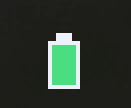

# InzoneBattery 精简版

Sony INZONE 耳机电量的**托盘图标版**：只有系统托盘里的一个电池图标，没有悬浮窗、没有设置窗口、不写配置文件。

和 [完整版](../README.md) 用同一套 HID 读取逻辑，显示的数字与完整版一致。

这个精简版放在仓库的 `lite/` 目录下，和完整版一起维护；下载和构建见文末。


实际在任务栏里的样子（截图，放大）：



## 特点

- **只有托盘图标**：图标本身就是电量条，绿色（>60%）/ 黄色（20–60%）/ 红色（<20%），耳机离线时是空心灰图标
- 鼠标悬停显示 `INZONE H5 · 85% · 充电中` 这样的提示
- 左键点图标：弹一个气泡，显示当前电量和「每 30 秒自动刷新」
- 30 秒自动刷新；读不到接收器（耳机没插）时图标变空心，不会卡死
- 电量低于 20% / 10% 各提醒一次（充电时不提醒）
- 开机自启动：注册表值名是 `InzoneBatteryLite`，**不会和完整版互相覆盖**，两个版本可以同时开着
- 解压即用：一个 exe，不依赖任何运行库（.NET Framework 4.x 系统自带）

## 右键菜单

```
INZONE H5 · 100%     ← 当前状态（不可点）
立即刷新
开机自动启动          ← 勾选状态跟着注册表走
重新显示托盘图标      ← 图标被系统吞了/explorer 重启后手动拉回
退出
```

没有「显示悬浮窗」「悬浮窗大小」「背景透明度」「锁定位置」这些项 —— 精简版没有悬浮窗。

## 命令行

```bat
:: 输出一次电量（纯数字，方便脚本调用）
InzoneBatteryLite.exe --once

:: 输出 JSON
InzoneBatteryLite.exe --json

:: 每 5 秒轮询，值变化时才打印（Ctrl+C 退出）
InzoneBatteryLite.exe --watch 5

:: 查看开机自启动状态
InzoneBatteryLite.exe --startup status

:: 开/关开机自启动
InzoneBatteryLite.exe --startup on
InzoneBatteryLite.exe --startup off

:: 列出 HID 集合，排障用
InzoneBatteryLite.exe --diag
```

## 和完整版的区别

| | 精简版 | 完整版 |
| --- | --- | --- |
| 托盘图标 | 有 | 有 |
| 悬浮窗 | 无 | 有（可拖动、缩放、吸附） |
| 设置窗口 / 背景透明度 | 无 | 有 |
| 配置文件 | 无 | `%APPDATA%\InzoneBattery\settings.ini` |
| 自启动注册表值 | `InzoneBatteryLite` | `InzoneBattery` |
| 日志 | `%TEMP%\InzoneBatteryLite-startup.log` | `%TEMP%\InzoneBattery-startup.log` |
| 适用 | 只想扫一眼电量，不想多个窗口 | 想要常驻的悬浮显示 |

## 开机自启动

菜单里勾选「开机自动启动」即可，也可以命令行 `--startup on`。

写入位置：`HKCU\Software\Microsoft\Windows\CurrentVersion\Run` 下的 `InzoneBatteryLite`。
写入后会回读校验；失败会弹窗并写日志，原因在：

```
%TEMP%\InzoneBatteryLite-startup.log
```

（如果 %TEMP% 不可写，会退回到 exe 同目录的 `startup.log`。）

**托盘图标不显示时**先看这个日志：

- `tray icon added` 但没有图标 → 图标在系统托盘的「^」溢出区里，拖到任务栏上即可
- `tray add failed err=5` → 进程的完整性级别低于任务栏。exe 文件如果带 Low 完整性标签，资源管理器会用受限令牌启动它，导致 `Shell_NotifyIcon` 被拒绝（ERROR_ACCESS_DENIED）。`build.ps1` 每次构建后会自动把 exe 的标签设成 Medium；手动修复：`build\SetIntegrity.exe InzoneBatteryLite.exe`

## 构建

需要 Windows 自带的 .NET Framework 4.x（`csc.exe` 在 `C:\Windows\Microsoft.NET\Framework64\v4.0.30319\`）。

```bat
cd lite
build.cmd
```

`build.ps1` 会编译出 `InzoneBatteryLite.exe`，然后自动设置完整性标签（原因见上一节）。

也可以直接用 CI 的构建产物：仓库 Actions 里每次 push 都会编译完整版和精简版，精简版产物名是 `InzoneBatteryLite-win`。

## 说明

- 只读取本地 USB 接收器的 HID 报文，不联网、不上传任何数据。
- 需要 Sony INZONE 的 USB 接收器插在电脑上（H5/H9/H7 这类 2.4G 型号）。
- 非官方工具，与 Sony 无关。Sony、INZONE 是 Sony 的商标。
- 许可证：MIT（见 [LICENSE](LICENSE)）。
